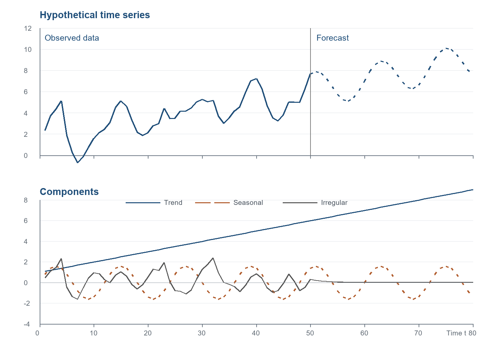

# 图1-1：假想时间序列及其分解

本图依据 Enders 第 1 章导言中的假想时间序列模型绘制：

- 上图：观测期与预测期的时间序列路径。
- 下图：趋势、季节和不规则成分。

## 模型与数据说明

趋势、季节和不规则成分分别满足：

    T_t = 1 + 0.1t
    S_t = 1.6 sin(tπ/6)
    I_t = 0.7I_t-1 + ε_t

其中预测期将未来随机扰动的期望设为零，因此不规则项逐渐衰减。由于教材没有给出每一期 ε_t 的具体数值，观测期的不规则项使用固定模拟冲击。本图是依据模型生成的模拟示例，不是真实观测数据，也不是原书逐点复制。

## 模型引用与图像说明

Enders, W. (2015). *Applied Econometric Time Series* (4th ed.). Wiley. [出版社配套网站](https://bcs.wiley.com/he-bcs/Books?action=index&bcsId=9288&itemId=1118808568).

本图为课程按模型重新模拟、绘制的图像，不是原书图片的扫描或复印。模型出处应随图保留；对原书图像的转载仍须依据出版方授权。
