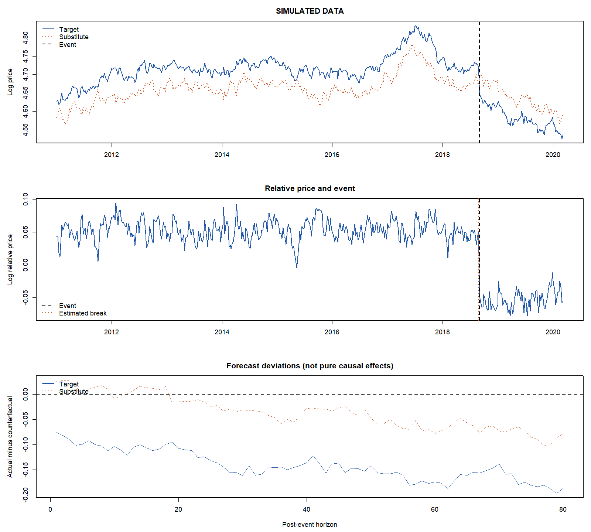

# 第8章 政策影响评估

协整与误差修正模型描述了价格之间的长期联系及其短期调整。本章进一步讨论：当关税、监管措施、采购规则或食品安全事件改变市场运行条件时，如何利用这些价格联系评估事件的影响。

政策实施后的价格变化并不等于政策造成的价格变化。产量、需求、汇率和运输成本可能同时变化；即使没有政策，价格也可能上涨或下跌。因此，政策评估必须构造一个反事实（counterfactual）：在未发生所研究事件的情况下，市场价格原本会如何变化。

替代品相对价格法（relative price of a substitute method，RPS）利用目标商品与替代品之间原有的价格关系，识别事件是否改变了市场均衡，并结合价格动态模型估计影响。本章以 RPS 为主线，把单位根、协整、结构变化检验和样本外预测连接为一套实证分析框架。

## 8.1 从价格变化到政策效应

### 8.1.1 观察价格与反事实价格

设目标商品的实际价格为 \(P_{1t}\)，其对数为 \(p_{1t}=\log P_{1t}\)。用 \(p_{1t}(1)\) 表示发生政策事件时的对数价格，用 \(p_{1t}(0)\) 表示未发生事件时的对数价格。对于已经受到政策影响的时期，我们观察到的是 \(p_{1t}(1)\)，而不是 \(p_{1t}(0)\)。

第 \(t\) 期的对数价格效应定义为：

$$
\tau_{1t}=p_{1t}(1)-p_{1t}(0).
$$

若 \(\tau_{1t}<0\)，政策使目标商品价格低于反事实水平。价格的实际百分比效应为：

$$
100\left[\frac{P_{1t}(1)}{P_{1t}(0)}-1\right]
=100\left(e^{\tau_{1t}}-1\right).
$$

当 \(\tau_{1t}\) 较小时，可以用 \(100\tau_{1t}\%\) 近似。例如，对数效应为 \(-0.08\) 时，精确百分比效应为 \(100(e^{-0.08}-1)\approx-7.69\%\)，不是精确的 \(-8\%\)。

### 8.1.2 为什么不能只比较事件前后均价

设 \(\mathcal W_0\) 为事件前窗口，\(\mathcal W_1\) 为事件后窗口，横线表示相应窗口内的平均值。事件前后价格差可以分解为：

$$
\overline p_{1,\mathcal W_1}(1)-\overline p_{1,\mathcal W_0}(0)
=\underbrace{\overline p_{1,\mathcal W_1}(1)-\overline p_{1,\mathcal W_1}(0)}_{\text{平均政策效应}}
+\underbrace{\overline p_{1,\mathcal W_1}(0)-\overline p_{1,\mathcal W_0}(0)}_{\text{无政策时本来会发生的变化}}.
$$

第二项可能来自共同市场趋势、季节性或其他供需冲击。因此，观察到价格下降，并不能直接判断政策压低了多少价格。政策甚至可能使价格上升，但同期更大的负向供给或需求冲击掩盖了这一效应。

**本节小结。** 政策效应是观察结果与反事实结果之差。事件前后的描述性比较提供线索，因果解释则取决于反事实的构造。

## 8.2 RPS 的经济逻辑

### 8.2.1 什么是替代品相对价格

设 \(P_{2t}\) 是替代品价格，定义价格比率和对数相对价格：

$$
R_t=\frac{P_{1t}}{P_{2t}},\qquad
r_t=\log R_t=p_{1t}-p_{2t}.
$$

\(R_t\) 表示一单位目标商品相对于替代品的价格。\(r_t\) 下降，说明目标商品相对变便宜；它既可能来自目标商品降价，也可能来自替代品涨价，或两者同时发生。

RPS 由 Carter 和 Smith（2007）提出。其出发点是：具有明确替代关系的商品往往受到相似的市场因素影响；若事件前的相对价格关系稳定，而事件后出现异常变化，这种变化可以为市场结构受到冲击提供证据。[原始论文](https://doi.org/10.1162/rest.89.3.522)

### 8.2.2 从一个简单需求模型理解相对价格

考虑消费者购买两种商品的例子。偏好为 Cobb–Douglas 形式：

$$
U(Q_1,Q_2)=Q_1^{\theta}Q_2^{1-\theta},\qquad 0<\theta<1,
$$

预算约束为：

$$
P_1Q_1+P_2Q_2=M.
$$

对效用函数取对数，并构造拉格朗日函数：

$$
\mathcal L=\theta\log Q_1+(1-\theta)\log Q_2
+\lambda(M-P_1Q_1-P_2Q_2).
$$

一阶条件给出：

$$
\frac{\theta}{Q_1}=\lambda P_1,\qquad
\frac{1-\theta}{Q_2}=\lambda P_2.
$$

将两个条件相除，消去 \(\lambda\)：

$$
\frac{P_1}{P_2}
=\frac{\theta}{1-\theta}\frac{Q_2}{Q_1}.
$$

取对数得到：

$$
\log\frac{P_1}{P_2}
=\log\frac{\theta}{1-\theta}+\log\frac{Q_2}{Q_1}.
$$

在两种商品的短期供给既定时，相对价格随偏好参数 \(\theta\) 变化。消费者对商品 1 的偏好下降，\(\theta\) 减小，其相对价格下降。共同收入变化 \(M\) 则不直接出现在这个价格比率中。

这个例子说明相对价格为何有助于区分共同变化和相对变化，但它不是所有市场都满足的结构模型。供给可调整、收入弹性不同或运输条件变化时，相对价格仍会受到这些因素影响。RPS 的实证依据是事件前关系的稳定性，而不是假定现实市场必然满足 Cobb–Douglas 偏好。

### 8.2.3 共同冲击在什么条件下被消除

以一个共同趋势模型进一步说明。设无政策时：

$$
p_{1t}(0)=a_1+b_1f_t+v_{1t},\qquad
p_{2t}(0)=a_2+b_2f_t+v_{2t},
$$

其中 \(f_t\) 是共同市场趋势，\(v_{1t}\) 和 \(v_{2t}\) 是平稳的特有成分。两式相减：

$$
r_t(0)=(a_1-a_2)+(b_1-b_2)f_t+(v_{1t}-v_{2t}).
$$

若 \(b_1=b_2\)，共同趋势被消除。若 \(b_1\ne b_2\)，相对价格仍保留共同趋势。两种商品“都受油价影响”并不足够；共同因素对两者的作用必须相近，或差异能够被合理建模。

事件发生后，设价格分别受到 \(\tau_{1t}\) 和 \(\tau_{2t}\) 的影响，则：

$$
r_t(1)-r_t(0)=\tau_{1t}-\tau_{2t}.
$$

相对价格直接识别的是两种商品的差异化效应。若政策使两者对数价格同幅变化，即 \(\tau_{1t}=\tau_{2t}\)，相对价格不变，RPS 无法仅凭价格比率发现这一共同效应。

**本节小结。** 相对价格能够过滤部分共同冲击，并保留两种商品受到的差异化冲击。过滤是否有效，需要经济机制和政策前数据共同支持。

## 8.3 RPS 的适用条件与三步实证流程

### 8.3.1 价格比率平稳意味着什么

假设两个对数价格分别为 \(I(1)\) 过程，而政策前：

$$
r_t=p_{1t}-p_{2t}\sim I(0).
$$

这说明两个价格存在协整向量 \((1,-1)'\)。允许非零均值 \(\mu\) 时，误差修正项为：

$$
z_t=p_{1t}-p_{2t}-\mu.
$$

\(z_t\) 平稳，表示价格可以共同漂移，但不会无限偏离原有相对价格关系。\(\mu\) 可以反映长期质量差异、运输差异或其他稳定价差，并不必然为零。

检验应首先在事件前样本中进行。若把事件后均衡变化一起纳入单位根检验，均值断点可能使平稳的相对价格看起来像非平稳过程。

### 8.3.2 一般协整不等于价格比率平稳

若只有如下关系成立：

$$
p_{1t}-\beta p_{2t}\sim I(0),\qquad\beta\ne1,
$$

则：

$$
p_{1t}-p_{2t}
=\underbrace{(p_{1t}-\beta p_{2t})}_{I(0)}
+\underbrace{(\beta-1)p_{2t}}_{\text{通常为 }I(1)}.
$$

因此，“两个价格协整”是比“价格比率平稳”更弱的结论。简单 RPS 需要特别考察 \((1,-1)'\) 这一向量是否合理。若必须估计自由系数 \(\beta\)，研究对象变为长期价格关系的偏离，其变化不再能直接解释为普通价格比率的变化。

对于预先给定的 \(p_{1t}-p_{2t}\)，可以直接使用单位根检验。对于先回归并估计 \(\widehat\beta\) 后得到的残差，则应采用残差协整检验的临界值，不能套用普通 ADF 临界值。

若两个价格本身都平稳，也可以研究稳定相对价格的事件变化，只是不需要借助 \(I(1)\) 变量的协整表示。单位根与 VECM 应服务于数据特征，而不应为了使用 RPS 强行设定价格都非平稳。

### 8.3.3 替代品的选择

合适的替代品应具有可解释的需求替代或投入替代关系，例如不同产地的大豆、饲料中的玉米与高粱、肉类加工中的不同品种牛。统计相关性只是辅助依据，不能代替经济机制。

价格还应具有可比口径，包括计量单位、货币、质量等级、交货条件、地点和观测频率。固定单位换算只改变对数价格差的截距；随时间变化的汇率、运费或质量构成变化却可能制造断点。

替代品应在事件前与目标商品保持稳定联系，并尽量避免受到同一事件的直接同向冲击。但替代品可能因需求转移而间接受到影响，这种溢出效应（spillover effect）必须纳入解释。对于大豆关税，美国与巴西大豆可以是替代品，但巴西价格不能自然地被当作“完全不受政策影响”的价格。

### 8.3.4 识别假设

把 RPS 结果解释为政策效应，主要依赖以下条件：

1. 无政策时，政策前的相对价格关系在评估窗口内仍然有效。
2. 没有与政策同期发生、足以单独改变相对价格的遗漏冲击。
3. 政策前估计窗口不包含明显预期效应（anticipation effect），价格口径也没有同期变化。
4. 分解两种商品的绝对价格效应时，无政策动态模型具有可信的预测能力，其误差分布可以由政策前数据合理近似。

结构变化检验不能自动验证这些假设。若采购决策本身是对目标商品相对供需变化的回应，政策时点就可能内生。相对价格可以过滤共同周期，却不能消除所有选择偏差。

### 8.3.5 三步实证流程总览

Adjemian、Smith 和 He 的 *Food Policy* 论文把 RPS 实证分析概括为三个步骤：验证事件前的相对价格关系稳定；识别事件附近的关系断点；利用事件前的预测模型估计断点后的平均预测误差。三步分别回答“原有关系是否可用”“关系何时改变”和“各市场受到多大影响”。以下依照作者公开稿第3.1—3.3节展开说明，统一使用本章符号。[方法来源：作者公开稿](https://agecon.uga.edu/content/dam/caes-subsite/ag-econ/documents/Estimating%20the%20Market%20Effect%20of%20a%20Trade%20War_rev1.pdf)

| 步骤 | 核心问题 | 使用的样本与方法 | 应形成的结果 |
| --- | --- | --- | --- |
| Step 1：验证稳定关系 | 没有事件时，两种价格是否保持稳定的相对关系？ | 事件前样本；价格口径核对、单位根和协整检验 | 可用于反事实的长期关系与估计区间 |
| Step 2：识别结构变化 | 相对价格关系是否在事件附近改变，影响区间有多长？ | 包含事件前后的样本；已知或未知断点检验 | 断点日期、各区间均值及均值变化 \(\Delta\mu\) |
| Step 3：预测并分解影响 | 旧关系若继续成立，两种价格会怎样变化？ | 稳定的事件前区间估计 ECM；对断点后的区间进行预测 | 两种价格的反事实路径、各自价格影响及不确定性 |

Step 1 不能由 Step 2 的显著断点替代：原本就不稳定的价格关系，不能直接用来构造稳定的反事实。Step 2 也不能由 Step 3 的大预测误差替代：预测误差可能来自模型失配，而不一定来自事件。只有先建立稳定关系，再确定关系变化，最后构造反事实，三个结果才能相互支持。

### 8.3.6 Step 1：验证事件前的相对价格关系是否稳定

第一步的目的，是确认所选替代品确实提供了一个可延续的价格基准，而不是寻找“相关系数最高”的商品。具体操作分为三项。

1. 根据需求或投入替代机制选择商品，整理同币种、同单位和可比交货条件的价格；画出两个对数价格及其差 \(r_t=p_{1t}-p_{2t}\)。
2. 划定不包含事件及明显预期效应的样本。先判断两个对数价格的单整性质，再检验这个样本中的对数价差是否平稳。
3. 若两个价格为 \(I(1)\)、价差为 \(I(0)\)，以协整检验及必要的向量限制检验核对长期关系是否支持 \((1,-1)'\)。同时检查该估计区间内是否已有其他明显制度变化。

最简单的长期关系为：

$$
r_t=\mu+u_t,\qquad u_t\sim I(0).
$$

这里要求的是价差围绕稳定均值波动，不是要求两个价格本身不变。两个价格可以一起上涨或下跌，只要偏离原有价差的部分具有均值回复性质。对于预先给定的价差，可以使用 ADF 等单位根检验；Johansen 检验则用于核对系统中的协整秩。检验不拒绝某个假设并不等于证明该假设成立，应结合样本长度、确定性项和其他证据判断。

论文还给出有条件的相对价格关系：

$$
r_t=\mu+\boldsymbol b'\boldsymbol Z_t+u_t,\qquad u_t\sim I(0),
$$

其中 \(\boldsymbol Z_t\) 为影响相对供需的变量。按照该文的设定，只有裸对数价差不能保持平稳时，才需要考虑这些变量。因此，一般 RPS 要求的可以是“控制相对供需因素后的偏离平稳”，不一定是无条件价差平稳。控制变量必须有经济依据；估计其系数后检验残差时，也不能机械套用普通 ADF 临界值。若以后用它们预测反事实，还需说明无政策情况下这些变量的路径如何获得。

在大豆关税应用中，作者认为美国和巴西大豆在需求上具有紧密替代关系。政策前检验显示，两国对数价格的单位根原假设未被拒绝，而对数价差的单位根原假设被拒绝；Johansen 检验支持一个协整关系。因此，这一应用不需要加入 \(\boldsymbol Z_t\)，可以从稳定的两国相对价格关系出发。

**第一步应报告的结果。** 给出替代品选择依据、价格口径、政策前样本区间、单位根与协整检验表，以及长期关系的具体表达式。若找不到可信的稳定关系，应重新选择替代品、建立有经济依据的条件关系，或改用其他评估方法，而不是直接进入后续预测。

### 8.3.7 Step 2：识别事件附近的相对价格结构断点

第二步的目的，是确定原有相对价格关系是否改变、何时改变，以及在哪个区间估计影响。它不是简单地把政策实施日写入回归，然后把所有实施后的观测合并为一个区间。

以不需要供需控制变量的应用为例，允许相对价格均值在不同区间发生变化：

$$
r_t=\mu_j+u_t,\qquad
B_{j-1}<t\le B_j,\qquad j=1,\ldots,m+1,
$$

其中 \(B_1,\ldots,B_m\) 为未知断点，\(B_0=0\)、\(B_{m+1}=T\) 为样本边界，\(\mu_j\) 为该区间的均衡均值。实际估计还应按需要处理 \(u_t\) 的序列相关和异方差。对于紧邻事件前后的两个区间，定义：

$$
\Delta\mu=\mu_{\mathrm{after}}-\mu_{\mathrm{before}}.
$$

若 \(\Delta\mu<0\)，目标商品相对替代品变便宜。这仍然是相对价格效应，不能直接解释为目标商品自身降价幅度。

具体操作包括：

1. 列出事件时间线，区分消息公布、政策正式实施和后续调整。先明确研究关注哪一次事件，不把统计断点自动当作政策发生日。
2. 对包含事件前后的相对价格序列进行结构变化检验。时点确实事前已知时，可以检验给定时点的变化；时点未知时，应采用未知断点或多断点程序，而不能用普通固定日期检验的临界值。
3. 估计断点及各区间均值，判断事件附近是否出现异常价差，并利用后续断点考察该价差是否消失或转入新的均衡。将这些日期与供需、物流和其他政策信息交叉核对。

*Food Policy* 的大豆应用使用 Bai–Perron 多个未知断点检验：通过序贯检验判断是否需要增加断点，再用 double-maximum 检验核对“无断点”相对于“未知数量断点”的证据。文章识别出2018年6月底附近的相对价格变化，并利用11月底附近的后续变化界定主要影响区间；这一窗口不是把关税正式实施日之后的所有数据都视为同一制度。

断点还有一个用途：帮助排除事件前已有的旧制度。该文用于 ECM 估计的稳定区间为2013年9月至2018年6月，而不是将所有早期价格不加区分地放入同一个模型。实证中可先提出初始政策前样本，再依据全样本断点证据检查并细化稳定区间；若区间改变，应重新核对第一步的长期关系。

**第二步应报告的结果。** 给出相对价格与断点图、断点数量和日期、最短区间等搜索设定、各区间均值、\(\widehat{\Delta\mu}\) 及其不确定性，并解释评估窗口的起止依据。统计断点只能说明价格关系改变；将它归因于政策，仍须排查同期的相对供需冲击。

### 8.3.8 Step 3：用事件前模型预测并估计各市场的价格影响

第三步的目的，是把相对价格的变化分解为两种商品各自的价格影响。在大豆应用中，巴西价格可能因贸易转移而上涨，所以不能把巴西当作完全不受政策影响的对照，也不能把美国—巴西价差的全部下降都归为美国价格损失。

先用第二步确定的稳定政策前区间估计双价格 ECM。长期部分使用第一步支持的均衡关系，短期部分包含两种价格变化的滞后项。选择滞后阶数、检查残差相关性，并考察政策前模型的预测表现；具体方程和递归过程见第8.6节。

然后固定事件前估计的参数，从事件前最后一期 \(T_0\) 出发，同时预测两种价格：

$$
\widehat p_{\mathrm{US},T_0+h\mid T_0}^{\,0},
\qquad
\widehat p_{\mathrm{Br},T_0+h\mid T_0}^{\,0}.
$$

这里的反事实是“政策前价格关系继续成立”的条件预测，不是“未来市场没有任何随机冲击”。后续预测递归使用已经预测的状态，不能逐期以受政策影响的实际价格更新反事实。否则，部分政策影响会被带入无政策路径。

实际价格与预测价格之差为：

$$
e_{i,h}=p_{i,T_0+h}
-\widehat p_{i,T_0+h\mid T_0}^{\,0},
\qquad i\in\{\mathrm{US},\mathrm{Br}\}.
$$

先画出两国实际与反事实价格，再画出 \(e_{i,h}\) 的路径。为理解平均效应，可以计算影响窗口 \(\mathcal W\) 内的简单平均：

$$
\widehat{PI}_{i,\mathrm{simple}}
=\frac{1}{|\mathcal W|}
\sum_{h\in\mathcal W}e_{i,h}.
$$

但该文第三步并不止于计算两个普通平均数。作者利用政策前模型的历史预测误差估计预测误差的方差与相关结构，对影响窗口内的美国价格预测误差进行加权。用归一化权重表示这一思路：

$$
\widehat{PI}_{\mathrm{US}}
=\sum_{h\in\mathcal W}w_h e_{\mathrm{US},h},
\qquad
\sum_{h\in\mathcal W}w_h=1.
$$

权重应由政策前的预测误差信息决定，而不是根据政策后哪几天损失最大来选择。由于同一起点的不同预测期误差往往既异方差又相互相关，不能只按逐期方差的倒数机械加权，更不能把它们当作独立样本计算标准误。这里的权重表达式用于说明估计思路，不是论文估计程序的完整复现；协方差加权及推断原理见第8.7节。

在原有相对关系可延续、其他相对冲击得到合理排查的设定下，事件造成的均衡价差变化满足：

$$
\Delta\mu=PI_{\mathrm{US}}-PI_{\mathrm{Br}}.
$$

因此，作者先估计美国价格影响，再利用第二步的相对均值变化推得巴西价格影响：

$$
\widehat{PI}_{\mathrm{Br}}
=\widehat{PI}_{\mathrm{US}}-\widehat{\Delta\mu}.
$$

例如，若相对价格的对数均值变化为 \(-0.15\)，美国对数价格影响估计为 \(-0.06\)，则巴西对数价格影响为 \(-0.06-(-0.15)=0.09\)。相对价差的下降由美国降价和巴西涨价共同构成，不能全部计入美国损失。这个例子只说明分解关系，不是论文结果。

最后报告价格影响及置信区间，并检查估计区间、评估窗口、滞后阶数和替代品改变后结果是否稳健。对数效应 \(PI_i\) 转换为百分比时使用 \(100(e^{PI_i}-1)\%\)；金额效应则需说明水平价格的反变换口径。断点搜索、均值变化和 ECM 参数的估计都会带来不确定性，不应只报告一个点估计。

**第三步应报告的结果。** 给出政策前 ECM 的设定与诊断、两种价格的反事实图、预测偏离图、两市场各自的影响和相对影响、权重及误差校准方法、置信区间与稳健性检验。本章第8.12节的教学代码仅展示简单平均预测偏离，不等于完成了论文的加权估计与正式推断。

**本节小结。** RPS 的三步实证流程依次建立稳定基准、识别关系变化、构造反事实并分解价格影响。第一步提供可用的长期关系，第二步给出断点和相对变化，第三步估计各市场自身的影响；三个步骤均成立，仍不免除对同期冲击与因果识别条件的论证。

## 8.4 相对价格的结构变化

### 8.4.1 已知事件时点：均值变化模型

若事件从 \(T_0+1\) 期开始影响市场，定义阶跃变量（step dummy）：

$$
D_t=\mathbf1(t>T_0).
$$

最简单的模型为：

$$
r_t=\mu+\delta D_t+u_t.
$$

事件前均值为 \(\mu\)，事件后均值为 \(\mu+\delta\)。\(\delta\) 是长期相对价格的对数变化。其精确比率效应为 \(100(e^\delta-1)\%\)。

检验原假设：

$$
H_0:\delta=0.
$$

若 \(u_t\) 有序列相关或异方差，普通 OLS 标准误可能不适用，可以采用 HAC 标准误。若事件时间确实事前给定，检验与在数据中搜索最显著时点的检验不同；不能先挑日期，再把它当作已知日期计算普通显著性。

### 8.4.2 为什么需要考虑短期动态

相对价格常具有持续性。允许 \(AR(1)\) 动态，并把均衡均值写为 \(m_t=\mu+\delta D_t\)：

$$
r_t-m_t=\phi(r_{t-1}-m_{t-1})+\varepsilon_t,
\qquad |\phi|<1.
$$

展开得到：

$$
r_t=(1-\phi)\mu+\phi r_{t-1}
+\delta D_t-\phi\delta D_{t-1}+\varepsilon_t.
$$

这一形式明确区分均衡均值变化 \(\delta\) 与短期持续性 \(\phi\)。在事件后的稳定区间，\(D_t=D_{t-1}=1\)，新增截距为 \((1-\phi)\delta\)，而均值变化仍然是 \(\delta\)。

另一个常见的干预模型（intervention model）为：

$$
r_t=c+\sum_{j=1}^{p}\phi_jr_{t-j}+\kappa D_t+\varepsilon_t.
$$

在参数稳定、AR 部分平稳时，事件前后长期均值分别为：

$$
\mu_0=\frac{c}{1-\sum_{j=1}^{p}\phi_j},\qquad
\mu_1=\frac{c+\kappa}{1-\sum_{j=1}^{p}\phi_j}.
$$

所以长期相对价格变化为：

$$
\mu_1-\mu_0=\frac{\kappa}{1-\sum_{j=1}^{p}\phi_j}.
$$

不能把含滞后因变量回归中阶跃变量的系数 \(\kappa\) 一律解释为长期效应。上述两个模型也具有不同的事件初始调整路径，实际选择应符合事件机制。

### 8.4.3 未知断点与多个断点

政策公告、信息泄露与正式执行可能发生在不同日期。若市场开始调整的时间未知，可以对候选断点 \(T_b\) 计算 Wald 或 F 统计量，并取最大值：

$$
\sup W=\sup_{T_b\in\mathcal T}W(T_b).
$$

候选集合 \(\mathcal T\) 通常经过修剪（trimming），排除样本两端，避免某一制度区间过短。由于检验包含搜索过程，\(\sup W\) 不能使用某一固定断点的普通 Wald 临界值。

若事件影响在数月后消退，可考虑多个制度区间：

$$
r_t=\mu_j+u_t,\qquad T_{j-1}<t\le T_j.
$$

Bai–Perron 方法可以估计多个未知断点。一个断点可能标志事件开始，另一个可能标志价格关系恢复。但断点位置、个数和最小区间长度都应报告；较短的政策效应可能被过长的最小区间设置排除。

**本节小结。** 结构变化分析用于判断原有价格关系是否改变以及何时改变。检验结果必须与事件时间线结合，均值变化也必须与短期动态系数区分。

## 8.5 相对价格效应与绝对价格效应

### 8.5.1 一个相对变化不能确定两个绝对变化

设评估窗口内两种商品的平均对数效应分别为 \(PI_1\) 和 \(PI_2\)。相对价格变化为：

$$
\delta=PI_1-PI_2.
$$

若 \(\delta=-0.10\)，以下三种情况都可能成立：

| 目标商品效应 \(PI_1\) | 替代品效应 \(PI_2\) | 相对效应 |
| --- | --- | --- |
| \(-0.10\) | \(0\) | \(-0.10\) |
| \(-0.06\) | \(0.04\) | \(-0.10\) |
| \(0\) | \(0.10\) | \(-0.10\) |

因此，只有在另有依据支持 \(PI_2=0\) 时，才能将相对效应直接解释为目标商品效应。即使 \(PI_2=0\)，这种解释仍然需要排除同期其他相对冲击。

### 8.5.2 RPS 的两个分析层次

第一层利用政策前的稳定相对价格关系及其断点，识别市场是否发生异常的相对调整。第二层利用政策前的动态模型构造两种价格的反事实路径，分解目标商品与替代品各自的影响。

第一层通过消除共同趋势提高识别精度；第二层仍然面对绝对价格中的共同冲击和预测不确定性。因此，绝对价格分解通常比相对效应估计更依赖模型和评估窗口。

**本节小结。** RPS 最直接的信息是差异化价格效应。估计目标商品自身的损失，还需要可信的反事实预测或其他识别条件。

## 8.6 用 ECM 构造无政策反事实

### 8.6.1 政策前的双变量误差修正模型

设两个对数价格的政策前长期关系为：

$$
z_t=p_{1t}-p_{2t}-\mu.
$$

双变量 ECM 可以写为：

$$
\Delta p_{1t}=c_1+\alpha_1z_{t-1}
+\sum_{j=1}^{k}\gamma_{11,j}\Delta p_{1,t-j}
+\sum_{j=1}^{k}\gamma_{12,j}\Delta p_{2,t-j}
+\varepsilon_{1t},
$$

$$
\Delta p_{2t}=c_2+\alpha_2z_{t-1}
+\sum_{j=1}^{k}\gamma_{21,j}\Delta p_{1,t-j}
+\sum_{j=1}^{k}\gamma_{22,j}\Delta p_{2,t-j}
+\varepsilon_{2t}.
$$

这里 \(k\) 是差分项的滞后阶数，对应水平 VAR 的阶数 \(K=k+1\)。确定性项应与协整检验一致，不能不加区分地同时加入均衡截距、自由漂移和趋势。

若 \(z_{t-1}>0\)，目标商品相对偏贵。\(\alpha_1<0\) 表示目标价格向下调整；\(\alpha_2>0\) 表示替代品价格向上调整。没有滞后差分项且确定性项相容时：

$$
z_t=(1+\alpha_1-\alpha_2)z_{t-1}
+\varepsilon_{1t}-\varepsilon_{2t}.
$$

相对价格均值回复要求：

$$
|1+\alpha_1-\alpha_2|<1.
$$

两个市场都可能承担调整任务，并不需要事先把替代品价格设为外生。加入短期滞后项后，应检查完整系统的动态稳定性。

### 8.6.2 固定政策前模型，递归预测两种价格

取未受事件及明显预期效应影响的样本估计模型，最后一期为 \(T_0\)。第一步预测把条件期望中的未来创新设为零：

$$
\widehat{\Delta p}_{1,T_0+1\mid T_0}^{\,0}
=\widehat c_1+\widehat\alpha_1z_{T_0}
+\sum_{j=1}^{k}\widehat\gamma_{11,j}\Delta p_{1,T_0+1-j}
+\sum_{j=1}^{k}\widehat\gamma_{12,j}\Delta p_{2,T_0+1-j}.
$$

价格水平预测为：

$$
\widehat p_{1,T_0+1\mid T_0}^{\,0}
=p_{1,T_0}+\widehat{\Delta p}_{1,T_0+1\mid T_0}^{\,0}.
$$

同时预测 \(p_2\)，再计算预测的误差修正项：

$$
\widehat z_{T_0+1\mid T_0}^{\,0}
=\widehat p_{1,T_0+1\mid T_0}^{\,0}
-\widehat p_{2,T_0+1\mid T_0}^{\,0}-\widehat\mu.
$$

以后各步使用已预测的价格、差分和误差修正项，递归生成整个无政策路径。上标 \(0\) 表示沿用旧制度，而不是假定未来市场完全没有其他冲击。

若事件也影响替代品，就不能把事件后的实际替代品价格直接代入“无政策”预测。这样会把政策的间接影响带入反事实。同样，固定起点反事实通常不应逐期用受政策影响的实际目标价格更新状态。

### 8.6.3 如何计算影响

定义实际对数价格与无政策预测之差：

$$
e_{i,h}=p_{i,T_0+h}-\widehat p_{i,T_0+h\mid T_0}^{\,0},
\qquad i=1,2.
$$

由定义可得：

$$
e_{i,h}=\tau_{i,T_0+h}
+\left[p_{i,T_0+h}(0)-\widehat p_{i,T_0+h\mid T_0}^{\,0}\right].
$$

预测误差由政策效应和无政策预测误差共同组成。把它解释为政策效应，依赖于后者无系统偏误，并且没有其他重要的差异化冲击。

长度为 \(H\) 的评估窗口内，简单平均估计为：

$$
\widehat{PI}_i(H)=\frac1H\sum_{h=1}^{H}e_{i,h}.
$$

相对效应为：

$$
\widehat{PI}_r(H)=\widehat{PI}_1(H)-\widehat{PI}_2(H)
=\frac1H\sum_{h=1}^{H}\left[r_{T_0+h}-\widehat r_{T_0+h\mid T_0}^{\,0}\right].
$$

平均对数效应转换为 \(100(e^{\widehat{PI}_i}-1)\%\)，表示窗口内几何平均价格比的变化。若需要算术平均百分比效应，应计算：

$$
\frac{100}{H}\sum_{h=1}^{H}(e^{e_{i,h}}-1).
$$

两个量一般不相等。金额损失还涉及水平价格的反变换；\(\exp(\widehat p)\) 是几何均值型预测，不能自动当作算术均值预测。若条件对数价格近似正态、预测方差为 \(s_h^2\)，条件均价为 \(\exp(\widehat p+s_h^2/2)\)。

**本节小结。** ECM 把政策前的长期关系和短期动态用于反事实预测。政策效应估计来自实际路径与旧制度预测路径之差，其可信度取决于模型稳定性、预测校准和同期冲击的解释。

## 8.7 统计推断：多期预测误差不能视为独立样本

### 8.7.1 平均效应的方差

同一起点产生的多期预测误差共享未来创新。例如，随机游走的第一步误差进入第二步误差，也进入更远期误差。因此，直接对 \(e_{i,1},\ldots,e_{i,H}\) 做普通独立样本 t 检验通常不合适。

设无政策预测误差向量为 \(\boldsymbol e_i^0\)，协方差矩阵为 \(\Omega_i\)。平均误差的方差为：

$$
\operatorname{Var}(\overline e_i^0)
=\frac1{H^2}\boldsymbol1_H'\Omega_i\boldsymbol1_H
=\frac1{H^2}\sum_{h=1}^{H}\sum_{j=1}^{H}
\operatorname{Cov}(e_{i,h}^0,e_{i,j}^0).
$$

双重求和中的非对角项不能随意忽略。两种价格之间也存在相关性，相对效应的方差为：

$$
\operatorname{Var}(\overline e_1^0-\overline e_2^0)
=\operatorname{Var}(\overline e_1^0)
+\operatorname{Var}(\overline e_2^0)
-2\operatorname{Cov}(\overline e_1^0,\overline e_2^0).
$$

若共同预测误差高度正相关，相减可以显著降低不确定性。这是相对效应可能比绝对价格效应更精确的原因。

### 8.7.2 用政策前的伪事件窗口校准

在政策前选择多个预测起点 \(s\)，分别生成长度同为 \(H\) 的动态预测误差：

$$
\boldsymbol e_s^0=
(e_{1,s,1}^0,\ldots,e_{1,s,H}^0,
e_{2,s,1}^0,\ldots,e_{2,s,H}^0)'.
$$

这些向量提供不同预测期之间、不同价格之间的协方差信息。也可以直接计算每个伪事件窗口的平均误差，考察正式事件的估计值在历史分布中有多异常。McKendree 等的研究利用政策前的多起点动态预测误差估计影响的不确定性。

严格的实时样本外检验应在每个起点只使用当时可获得的信息估计模型。若固定使用整个政策前样本估计的参数，得到的是历史预测误差校准，两者需要区分。伪事件窗口重叠时，平均误差也不是独立观测；不能用窗口数量直接缩小标准误。

模型依赖的 bootstrap 可以进一步纳入参数估计误差。若采用分块 bootstrap，应使用成熟包，并明确保留了哪些序列依赖。协整系统不能通过随意打乱价格水平进行重抽样。

### 8.7.3 协方差加权的含义

为说明文献中的加权思想，设窗口内效应近似常数，并令：

$$
\boldsymbol e=X\boldsymbol{PI}+\boldsymbol\eta,\qquad
X=\begin{bmatrix}\boldsymbol1_H&\boldsymbol0_H\\
\boldsymbol0_H&\boldsymbol1_H\end{bmatrix},\qquad
\boldsymbol{PI}=\begin{bmatrix}PI_1\\PI_2\end{bmatrix}.
$$

若 \(\operatorname{Var}(\boldsymbol\eta)=\Omega\)，广义最小二乘估计为：

$$
\widehat{\boldsymbol{PI}}_{GLS}
=(X'\Omega^{-1}X)^{-1}X'\Omega^{-1}\boldsymbol e.
$$

已知或精确估计的相对均值变化还可以作为 \(PI_1-PI_2=\delta\) 的约束。这里给出的是加权估计的一般原理，不是对每篇 RPS 论文估计程序的逐行复现。实际应用应同时处理 \(\widehat\Omega\)、断点和 \(\widehat\delta\) 的估计不确定性。若效应随时间明显变化，加权常数效应与简单平均效应的含义也不同。

**本节小结。** RPS 推断需要同时考虑跨预测期和跨市场相关性。逐期预测区间不能直接代替整个窗口平均政策效应的置信区间。

## 8.8 评估窗口与效应持续性

可以分别报告逐期效应 \(e_{i,h}\)、固定窗口平均效应 \(\widehat{PI}_i(H)\) 和扩展影响窗口平均效应。三者回答不同问题：某期影响多大、某段时期平均影响多大，以及延长观察期后估计是否改变。

本章的扩展影响窗口（expanding impact window）是固定政策前模型、延长事件后的观察区间；它不等于用事件后数据不断重新估计模型的扩展估计窗口。

若真实效应只持续 \(H_0\) 期，每期为 \(\tau\)，随后归零，则对于 \(H>H_0\)：

$$
\overline\tau(H)=\frac{H_0}{H}\tau.
$$

平均效应会随窗口扩大而接近零。因此，长窗口估计不显著，可能来自影响被平均稀释或不确定性扩大，不能单凭这一点确定效应消失的准确日期。应结合逐期路径、后续断点和其他事件证据判断。

在两个价格都含单位根时，绝对价格的远期反事实尤其不确定。长窗口中又可能出现新政策、新收成或新需求冲击。窗口应由研究问题和事件机制决定，并报告对窗口选择的敏感性。

**本节小结。** 政策影响的大小和持续性是两个不同问题。延长窗口提供更多后续信息，也增加反事实不确定性和同期事件干扰。

## 8.9 三个应用案例

### 8.9.1 StarLink 玉米事件：食品安全信息与相对需求

Carter 和 Smith（2007）研究未经批准用于人类食用的 StarLink 玉米进入食品供应链后的价格影响，以高粱作为玉米的替代品。论文利用事件前稳定的玉米—高粱价格关系，检验事件后的异常变化，并估计玉米价格影响。论文报告约 6.8% 的价格折价，持续至少一年。[论文摘要与书目信息](https://doi.org/10.1162/rest.89.3.522)

这个案例适合解释替代机制：食品安全信息可以降低对一种商品的需求，同时将部分需求转向替代品。实证问题既包括相对折价，也包括目标市场自身的价格损失。案例属于市场事件评估，并非政府政策的随机试验。

### 8.9.2 大豆关税：政策影响可以同时作用于两个市场

Adjemian、Smith 和 He（2021）研究中国对美国大豆加征关税，比较美国与巴西大豆价格。作者公开稿报告：美国出口价格平均降低约 0.74 美元/蒲式耳，巴西价格提高约 0.97 美元/蒲式耳，主要价格影响窗口约为五个月。[作者公开稿](https://agecon.uga.edu/content/dam/caes-subsite/ag-econ/documents/Estimating%20the%20Market%20Effect%20of%20a%20Trade%20War_rev1.pdf)

这说明巴西大豆既提供共同市场的信息，也受到贸易转移影响。相对价差不能全部解释为美国价格损失。作者结合相对价格断点与 ECM 预测分解两国价格影响，而不是假设巴西价格完全不受影响。[期刊论文](https://doi.org/10.1016/j.foodpol.2021.102152)

还应区分价格恢复与贸易数量恢复：相对价格重新接近原有关系，并不意味着出口结构、库存或生产者收入已经恢复。价格指标只是政策影响的一个维度。

### 8.9.3 荷斯坦牛采购：企业规则与供应链传导

McKendree、Saitone 和 Schaefer 的论文于 2020 年在线发表，编入 2021 年期刊卷期。研究考察 Tyson 一处屠宰设施停止采购荷斯坦牛的决定，以传统肉牛价格作为替代品价格，在活牛、胴体和架子牛环节分别进行 RPS 分析。

作者首先检验事件前的单位根和 \((1,-1)'\) 协整关系，再识别相对价格断点，最后用事件前 VECM 预测无事件价格，并延长事件后影响窗口。论文报告荷斯坦活牛和胴体价格分别下降约 5.5% 和 3.5%；上游架子牛最初下降约 22%，后续均衡约低于事件前 4.8%。这些是论文报告值，不是本章重新估计的结果。[期刊论文](https://doi.org/10.1111/ajae.12159)

采购决定是企业战略选择，作者也明确讨论其并非天然外生。对于本章，关键问题是：共同牛周期是否已经由相对价格过滤，事件前是否出现目标品种特有的供需变化，以及不同供应链环节为何具有不同的调整速度。

**本节小结。** 三个案例分别涉及食品安全信息、公共贸易政策和企业采购规则。共同方法是利用事件前价格联系评估事件后的异常变化；因果可信度仍须由各案例的制度背景支撑。

## 8.10 从价格影响到收入与福利

若只考察价格变化，并把数量固定在 \(Q_t^*\)，价格引起的收入变化近似为：

$$
\Delta Rev_P=\sum_{t\in\mathcal W}
\left[P_{1t}(1)-P_{1t}(0)\right]Q_t^*.
$$

它是给定数量下的价格收入效应，不是完整福利变化。单期总收入变化可以分解为：

$$
P_t(1)Q_t(1)-P_t(0)Q_t(0)
=[P_t(1)-P_t(0)]Q_t(0)
+P_t(1)[Q_t(1)-Q_t(0)].
$$

第一项来自价格变化，第二项来自数量变化。若关税改变出口数量、储存成本、物流方向或种植结构，单纯的价格损失不能覆盖所有经济损失。利润还涉及成本，福利还涉及生产者剩余、消费者剩余、政府收入等。

因此，RPS 价格效应与政策补贴之间可以进行有口径说明的比较，却不能因为二者不相等就直接认定补贴过度或不足。

**本节小结。** 价格评估为收入和福利分析提供输入。数量、成本及其他主体的变化仍需要额外数据和经济模型。

## 8.11 RPS 与其他政策评估方法

| 方法 | 主要反事实依据 | 适用问题与主要要求 |
| --- | --- | --- |
| RPS | 政策前稳定的替代品相对价格及动态关系 | 价格联系紧密的市场事件；需要排查其他相对冲击 |
| 双重差分（difference-in-differences，DID） | 处理组与对照组的无政策平行趋势 | 面板政策比较；通常要求对照组不受处理溢出影响 |
| 合成控制（synthetic control） | 多个供体构成的加权反事实 | 单一处理单位；依赖政策前拟合与可信供体 |
| 中断时间序列（interrupted time series） | 原有水平、趋势和动态的延续 | 明确干预时点；特别依赖对同期变化的排查 |
| 结构供需或贸易模型 | 政策改变后的经济均衡模拟 | 可研究数量和福利；依赖结构假设与参数 |

若只比较两种商品的事件前后对数价格，RPS 的简单均值变化在代数上具有“差上再差”的形式。但 RPS 文献进一步利用协整、未知断点和 ECM 预测，并允许讨论替代市场受到的影响。因此，不能把任何替代品都视作 DID 中不受处理的对照组，也不能认为两者只因代数相似就具有相同识别假设。

**本节小结。** 方法选择应服从研究对象、数据结构和识别条件。RPS 对价格数据丰富、数量或完整供需数据不足的市场事件尤其有用，但不能替代所有政策评估设计。

## 8.12 R 代码示例：用现成包连接检验与预测

### 8.12.1 数据与教学范围

下面的检验与预测分别对应第8.3节的 Step 1—Step 3。代码负责演示三步之间的数据衔接；第三步使用简单平均预测偏离，未实现 Food Policy 论文的协方差加权影响估计与正式置信区间。

本章配套脚本为 `脚本/替代品相对价格法示例.R`，网页提供[完整脚本下载](脚本/替代品相对价格法示例.R)。检验、估计和预测分别使用 `urca`、`strucchange`、`sandwich`、`lmtest` 和 `vars`。

示例默认生成两种共享随机趋势的模拟价格，在事件后给目标价格加入 \(-0.08\) 的对数效应，给替代品加入 \(0.03\) 的对数效应。因此，已知相对效应为 \(-0.11\)。模拟用于检查分析步骤，不代表任何真实政策的实证结果。完整脚本也支持读取实际价格 CSV，所需列为 `date`、`price_target` 和 `price_substitute`。

数据应按共同交易日或统一时间间隔整理，不能把某市场缺报日随意填为零。对于缺报、停牌或薄市场报价，还应核查观测是否反映实际交易。

### 8.12.2 政策前平稳性与协整

```r
library(urca)
library(vars)

pre <- dat[dat$date < event_date, ]
pre$r <- log(pre$price_target) - log(pre$price_substitute)

summary(ur.df(log(pre$price_target), type = "drift",
              lags = 8, selectlags = "BIC"))
summary(ur.df(log(pre$price_substitute), type = "drift",
              lags = 8, selectlags = "BIC"))
summary(ur.df(pre$r, type = "drift",
              lags = 8, selectlags = "BIC"))

y_pre <- cbind(target = log(pre$price_target),
               substitute = log(pre$price_substitute))
lag_choice <- VARselect(y_pre, lag.max = 8, type = "const")
K <- max(2L, as.integer(lag_choice$selection["SC(n)"]))
jo <- ca.jo(y_pre, type = "trace", ecdet = "const", K = K)
summary(jo)
```

`ca.jo()` 的 `K` 是水平 VAR 阶数。示例至少取 2，是该函数实现的要求，并非所有经济系统都至少需要两阶。实际研究应比较确定性项、滞后阶数与残差诊断。

在协整秩为 1 的前提下，还可检验斜率为 1 的限制。对于两价格加协整截距的模型，下面的限制矩阵允许向量为 \((a,-a,c)'\)：

```r
H_ratio <- cbind(c(1, -1, 0), c(0, 0, 1))
summary(blrtest(jo, H = H_ratio, r = 1))
```

不拒绝限制不等于证明它正确；结果仍需与直接的价格比率检验及经济关系结合。

### 8.12.3 已知与未知断点

```r
library(strucchange)
library(lmtest)
library(sandwich)

dat$r <- log(dat$price_target) - log(dat$price_substitute)
dat$post <- as.integer(dat$date >= event_date)

# 事前给定日期：相对均值变化，使用 HAC 标准误。
mean_shift <- lm(r ~ post, data = dat)
coeftest(mean_shift, vcov. = NeweyWest(mean_shift,
                                    prewhite = FALSE, adjust = TRUE))

# 未知单断点：HAC 协方差下的 supF 检验。
fs <- Fstats(r ~ 1, data = dat, from = 0.15,
             vcov. = function(m) NeweyWest(m, prewhite = FALSE,
                                         adjust = TRUE))
sctest(fs, type = "supF")

# 多断点分段均值：根据 BIC 选择断点数。
bp_full <- breakpoints(r ~ 1, data = dat, h = 0.15)
bp <- breakpoints(bp_full)
summary(bp_full)
dat$date[bp$breakpoints]
```

这里的均值回归是简化教学形式。`Fstats()` 的稳健协方差用于检验；`breakpoints()` 的分段最小二乘用于日期估计，两者不是相同统计量。BIC 选择和默认断点区间也不自动等于文献的稳健序贯检验程序。对于显著序列依赖，应比较显式动态模型及相应推断。

### 8.12.4 VECM 反事实与平均影响

```r
# 以下教学示例采用 r = 1；实际数据须先判断协整秩。
vec <- vec2var(jo, r = 1)
post_dat <- dat[dat$date >= event_date, ]
H <- nrow(post_dat)

# 所有预测从事件前最后一期出发，不用事件后价格更新。
fc <- predict(vec, n.ahead = H, ci = 0.95)
cf_log <- cbind(target = fc$fcst$target[, "fcst"],
                substitute = fc$fcst$substitute[, "fcst"])
actual_log <- cbind(target = log(post_dat$price_target),
                    substitute = log(post_dat$price_substitute))
errors <- actual_log - cf_log
PI_log <- colMeans(errors)
PI_percent_geometric <- 100 * expm1(PI_log)
PI_log
PI_percent_geometric
mean(errors[, "target"] - errors[, "substitute"])
```

`vec2var()` 保留 `ca.jo()` 估计的协整向量，并未因为运行了 `blrtest()` 就自动施加 \((1,-1)'\) 限制。因此，这段示例是基于估计协整关系的反事实演示。若实际研究要求严格复现固定价格比率的 RPS，应使用支持该限制的估计程序，并核对原文设定。

`predict()` 给出的逐期区间是模型预测区间，不是平均政策效应区间。完整脚本输出价格预测、逐期误差及不同窗口的平均效应；不把模拟价格生成的回归显著性作为真实因果证据，也不对多期误差直接执行独立样本 t 检验。

### 8.12.5 实际运行结果与解释

使用配套脚本的默认随机种子，在本机 R 4.2.2 中运行，得到以下平均对数价格偏离。窗口单位是模拟中的周，不是论文中的交易日。

| 事件后窗口 | 目标价格偏离 | 替代品价格偏离 | 相对价格偏离 |
| --- | --- | --- | --- |
| 前 10 周 | −0.0959 | 0.0142 | −0.1101 |
| 前 20 周 | −0.1013 | 0.0092 | −0.1105 |
| 前 40 周 | −0.1214 | −0.0116 | −0.1098 |
| 前 80 周 | −0.1420 | −0.0361 | −0.1060 |

真实模拟效应分别为 \(-0.08\)、\(0.03\) 和 \(-0.11\)。随着预测期延长，两个绝对价格偏离都受同一共同随机趋势的实现路径影响，替代品的预测偏离甚至变成负值；这不表示给定的模拟政策改变了方向。两个价格相减之后，大部分共同误差被消除，相对效应估计仍接近 \(-0.11\)。这一结果说明单次长窗口预测偏离不能直接等同于真实政策效应。

固定日期均值回归的相对变化估计为 \(-0.1055\)，HAC 标准误约为 \(0.0029\)。分段均值模型的 BIC 选择一个断点，定位在第 400 个观测，即事件前最后一周；事件从第 401 个观测开始。模型诊断的调整 Portmanteau 检验 p 值约为 \(0.929\)。这些是教学模拟结果，并非真实市场检验结果。

还应如实解释单位根检验：虽然数据生成过程包含共同随机游走，这次有限样本的两个价格 ADF 统计量约为 \(-2.98\) 和 \(-3.31\)，在 5% 水平会拒绝单位根。相对价格统计量约为 \(-8.41\)；Johansen 检验支持一个协整向量，价格斜率为 1 的限制检验 p 值约为 \(0.74\)。模拟已知真实过程，实际数据却未知，因此出现检验分歧时，应比较确定性项、样本区间和其他检验，不能隐去不符合预期的结果。



图8-1为模拟数据。第一幅比较两个对数价格，第二幅展示价格差与事件日期，第三幅展示固定事件前模型生成的预测偏离。蓝色实线为目标商品，橙色点线为替代品；竖直虚线表示模拟事件起点，点线表示分段模型估计的断点。第三幅没有给出政策效应置信带，曲线不能解释为不含预测误差的因果效应路径。

**本节小结。** 现成包负责统计计算，研究者负责价格口径、事件定义、协整限制、反事实设定和效应解释。可运行代码并不能代替识别论证。

## 8.13 实证报告与课程练习

一份 RPS 实证报告应依次展示事件时间线、替代关系、价格数据口径、政策前稳定性、断点证据、反事实路径、效应与不确定性，并解释同期事件和稳健性结果。图表至少应呈现两种价格、相对价格与断点，以及实际价格相对反事实的偏离。

报告正文可按三步组织：Step 1 展示数据和长期关系检验，说明反事实基准为何可用；Step 2 展示断点检验、相对均值变化和影响窗口，说明价格关系何时改变；Step 3 展示政策前模型、反事实预测、各市场影响和统计推断，说明影响如何计算。结论应区分相对价格变化与两市场自身效应，不能以某一步的显著结果代替完整证据链。

课程练习可以分为两部分。第一部分运行配套模拟脚本，比较目标商品效应、替代品效应和相对效应，观察把替代品当作不受影响对照的后果。第二部分选读一个应用案例，说明其替代品选择、政策前样本、事件时点和推断方式，并指出最可能威胁因果解释的同期变化。

进阶练习可以取得可公开下载的真实价格数据，对不同估计窗口、影响窗口、滞后阶数和替代品进行敏感性分析。若无法取得论文原始数据，应明确称为方法应用或教学演示，不能称为论文复现。

## 8.14 本章总结

RPS 将商品替代关系转化为时间序列评估依据。政策前相对价格稳定，意味着市场存在可利用的长期联系；事件后结构变化提供关系受到冲击的证据；ECM 则利用原有均衡和短期动态构造无政策价格路径。

相对效应与绝对效应必须区分。替代品可能受到需求转移，价格比率的变化因而表示两市场效应之差。将其分解为目标商品损失和替代品收益，需要额外的预测依据，并面对绝对价格的共同趋势和远期不确定性。

最后，统计断点、异常预测误差和因果效应不是同一个概念。只有在政策前关系可延续、同期差异化冲击得到合理排查、反事实预测经过校准时，RPS 才能为政策影响提供可信解释。

## 8.15 思考题

1. 为什么政策后的实际价格变化不能直接解释为政策效应？
2. 从消费者的一阶条件推导 Cobb–Douglas 模型中的相对价格关系。
3. 在共同趋势模型中，什么条件使对数价格差消除共同趋势？
4. 两价格存在协整关系，为什么不一定意味着其价格比率平稳？
5. 若目标价格下降 6%、替代品价格上升 4%，如何计算精确相对价格变化？
6. 在含滞后因变量的阶跃干预回归中，为什么阶跃系数未必是长期效应？
7. 未知断点搜索为什么不能沿用固定断点检验的普通临界值？
8. 若政策影响替代品，使用其事件后实际价格构造反事实会出现什么问题？
9. 为什么同一起点的多期预测误差相关？这种相关性如何影响平均效应的标准误？
10. 扩展影响窗口与扩展估计窗口有什么区别？
11. 相对价格恢复是否意味着贸易数量、收入和福利恢复？
12. 分析三个案例中哪一种同期变化最可能威胁 RPS 的政策解释，并提出可行的稳健性检验。

## 8.16 参考文献

1. Carter, C. A., and A. Smith. 2007. “Estimating the Market Effect of a Food Scare: The Case of Genetically Modified StarLink Corn.” *The Review of Economics and Statistics*, 89(3): 522–533. [期刊链接](https://doi.org/10.1162/rest.89.3.522)。
2. Adjemian, M. K., A. Smith, and W. He. 2021. “Estimating the Market Effect of a Trade War: The Case of Soybean Tariffs.” *Food Policy*, 105: 102152. [期刊链接](https://doi.org/10.1016/j.foodpol.2021.102152)；[作者公开稿，2021 年 6 月版本](https://agecon.uga.edu/content/dam/caes-subsite/ag-econ/documents/Estimating%20the%20Market%20Effect%20of%20a%20Trade%20War_rev1.pdf)。
3. McKendree, M. G. S., T. L. Saitone, and K. A. Schaefer. 2021. “Oligopsonistic Input Substitution in a Thin Market.” *American Journal of Agricultural Economics*, 103(4): 1414–1432. 2020 年 11 月 13 日在线发表。[期刊链接](https://doi.org/10.1111/ajae.12159)。
4. R 实现文档：[urca](https://cran.r-project.org/package=urca)、[vars](https://cran.r-project.org/package=vars)、[strucchange](https://cran.r-project.org/package=strucchange)、[sandwich](https://cran.r-project.org/package=sandwich)、[lmtest](https://cran.r-project.org/package=lmtest)。

本章的符号、推导和教学代码统一为课程表述，不逐字翻译论文，也不宣称完整复现各文献的估计程序。案例数值来自所列论文或明确标注的作者稿；模拟结果另行标注。
