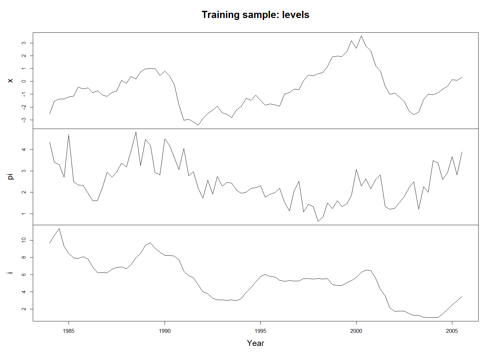
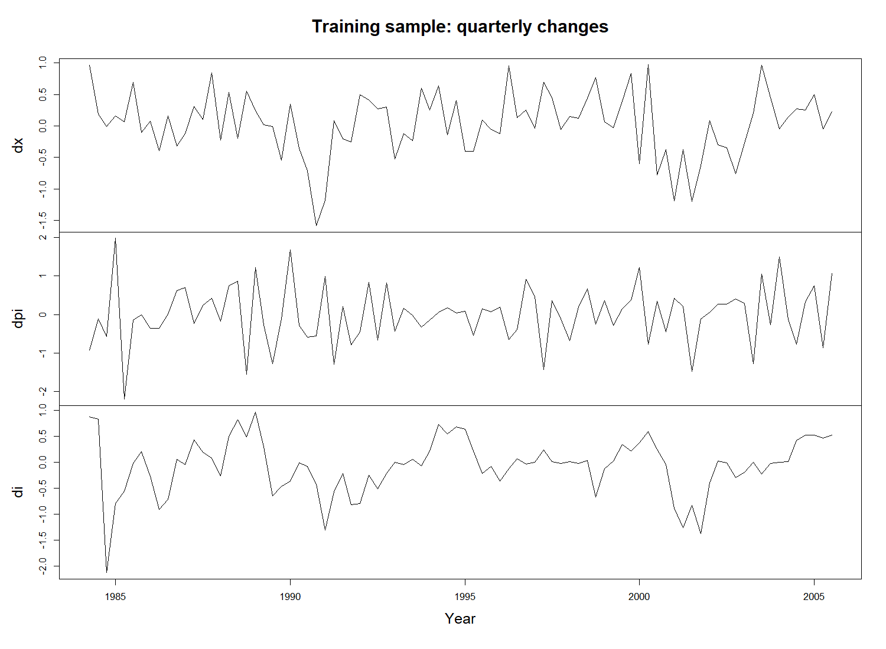
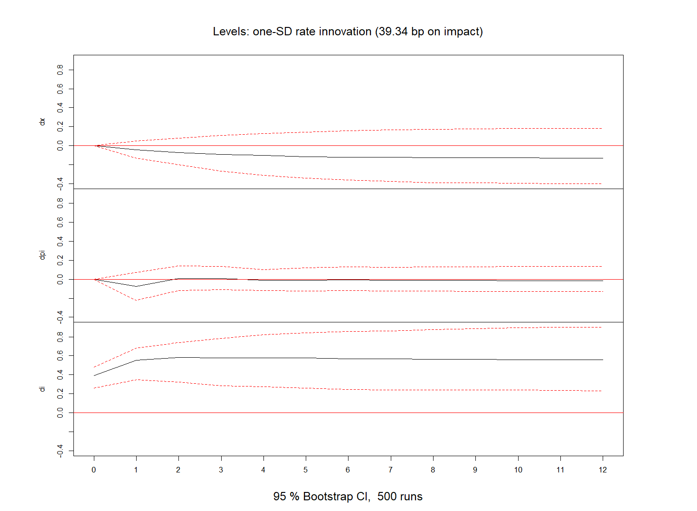
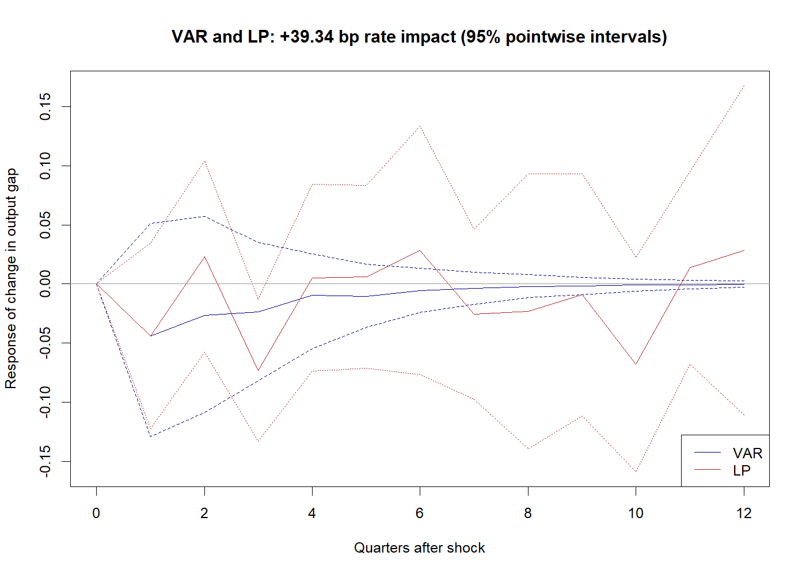
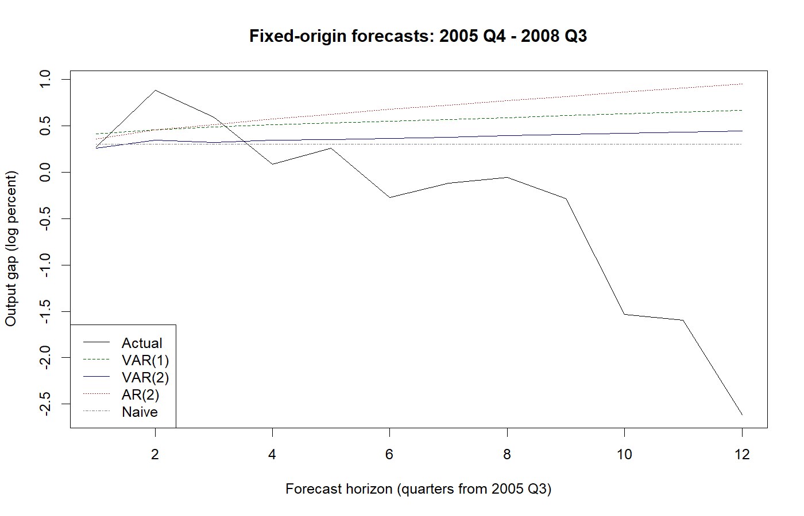

# Lab 2

**美国产出缺口、通胀与利率：VAR、SVAR 与局部投影**

本实验从三个宏观变量的时间序列图出发，依次完成平稳性检验、VAR 选阶与诊断、递归结构识别、脉冲响应、方差分解、历史分解、反事实分析、局部投影（LP）和样本外预测比较。各步骤调用现有 R 包中的函数，代码附有参数含义和结果解释。

## 下载数据和代码

- [下载数据：lab 2.csv](lab%202.csv){ download="lab 2.csv" }
- [下载 R 代码：Lab 2.R](Lab%202.R){ download="Lab 2.R" }
- [在 GitHub 查看 Lab 2](https://github.com/ZhepengHuCAU/Time-seriese-analysis-China-Agricultural-University/tree/main/Lab%202)

将数据和代码放在同一个文件夹中，并保留原文件名。如果浏览器直接显示文件内容，可右键下载链接，选择“链接另存为”。

## 如何运行

1. 用 RStudio 打开 `Lab 2.R`，编码选择 UTF-8。
2. 选择 **Session → Set Working Directory → To Source File Location**，将工作目录设为代码所在文件夹。
3. 首次运行时，去掉 `install.packages(...)` 一行前的 `#`，运行该行安装所需包。
4. 从 `library(...)` 开始，逐节选中代码并按 **Ctrl+Enter**。先检查当前结果，再进入下一步。

也可以在工作目录设置正确后一次运行：

```r
source("Lab 2.R", encoding = "UTF-8")
```

运行后，16 张图、检验表、预测比较表和运行环境信息保存在同一目录的 `Lab2_output` 文件夹。脚本用 `png()` 与 `dev.off()` 直接保存图片；在文件浏览器中打开即可查看。

## 数据与样本

数据来自 R 包 `svars` 的 [`USA` 数据集](https://search.r-project.org/CRAN/refmans/svars/html/USA.html)，原始来源为 FRED。CSV 从 `svars 1.3.12` 的实际数据导出，按时间属性核验为 1965 年第一季度至 2008 年第三季度的 175 个季度观测。

### 与章节代码示例的数据关系

本实验使用美国数据；本章的部分简短代码示例使用加拿大数据。两套数据的国家、变量和样本范围不同：

| 使用位置 | 数据集与国家 | 变量 | 完整样本 |
|---|---|---|---|
| Lab 2；异方差 SVAR、历史分解与反事实示例 | `svars::USA`，美国 | `x` 产出缺口、`pi` 通胀率、`i` 联邦基金利率 | 1965Q1—2008Q3；本实验 CSV 为 175 期 |
| 章节中的 VAR、递归 SVAR、LP 简短示例 | `vars::Canada`，加拿大 | `e` 就业、`prod` 劳动生产率、`rw` 实际工资、`U` 失业率 | 1980Q1—2000Q4；84 期 |

章节示例的加拿大数据定义见 [`vars::Canada` 官方文档](https://search.r-project.org/CRAN/refmans/vars/html/Canada.html)。本实验下载的 `lab 2.csv` 对应美国 `USA` 数据集，代码和结果中的 `x`、`pi`、`i` 均按美国变量定义解释。

| 变量 | 定义 | 读数的经济含义 |
|---|---|---|
| `x` | 产出缺口：\(100\log(实际GDP/潜在GDP)\) | 正值表示实际产出高于潜在产出；不是实际 GDP 的对数水平 |
| `pi` | GDP 平减指数的环比年化通胀率，单位为 % | 衡量价格变化速度；不是价格指数 |
| `i` | 联邦基金利率，单位为 % | 例如由 4 上升至 5，表示上升 1 个百分点 |

主分析采用 1984 年第一季度至 2008 年第三季度。1984 年后的美国经济常与“大缓和”背景联系起来，指产出和通胀波动较此前降低。[Bernanke（2004）](https://www.federalreserve.gov/boarddocs/speeches/2004/20040220/default.htm)讨论了这一历史背景。它只是样本选择的经济依据，不能保证三个序列平稳，也不能保证模型参数在样本内不变；样本末期还包含金融危机初期。

| 用途 | 时间范围 | 水平观测数 |
|---|---|---:|
| 训练样本 | 1984 年第一季度—2005 年第三季度 | 87 |
| 测试样本 | 2005 年第四季度—2008 年第三季度 | 12 |

平稳性检验、选阶、参数估计、结构识别和模型诊断只使用训练样本。测试样本保留到预测评价阶段。时间序列不能随机打乱后划分训练集与测试集。

主样本先做一阶差分，因此训练期差分数据从 1984 年第二季度开始，共 86 期；测试期差分仍有 12 期，第一期使用已经观察到的 2005 年第三季度水平计算。

## 1. 先画图，再检验平稳性 {#stationarity}

先观察 `x`、`pi`、`i` 的水平图：均值是否缓慢移动，是否存在高波动时期，金融危机附近是否出现明显变化。图形可以提供线索，但不能代替统计检验。



图中只显示训练期。完整 1965—2008 年图见 [01_full_history.png](Lab2_output/01_full_history.png)。

三个变量分别进行以下检验：

| 检验 | 原假设 | 本实验设定 | 如何拒绝原假设 |
|---|---|---|---|
| ADF | 存在单位根 | 含常数、无时间趋势；最多 4 个差分滞后，用 BIC 选阶 | `tau2` 小于相应临界值，即更负 |
| PP | 存在单位根 | 含常数、无时间趋势；Z-tau，短带宽 | Z-tau 小于相应临界值，即更负 |
| KPSS | 围绕固定均值平稳 | `type = "mu"`，短带宽 | 统计量大于相应临界值 |

例如，对训练样本中的产出缺口检验时，核心调用为：

```r
adf_x <- urca::ur.df(y_train[, "x"], type = "drift", lags = 4, selectlags = "BIC")
pp_x <- urca::ur.pp(y_train[, "x"], type = "Z-tau", model = "constant", lags = "short")
kpss_x <- urca::ur.kpss(y_train[, "x"], type = "mu", lags = "short")
summary(adf_x)
summary(pp_x)
summary(kpss_x)
```

这里 `y_train[, "x"]` 取出训练期的产出缺口。使用 `summary()` 阅读完整统计量和临界值。ADF 输出回归表中的普通 t 检验 p 值，不是单位根检验的 p 值。

### 水平值与一阶差分的检验结果

| 对象 | ADF tau2 | PP Z-tau | KPSS |
|---|---:|---:|---:|
| `x` | −2.7039 | −2.1631 | 0.2850 |
| `pi` | −2.8894 | −3.9211 | 0.7121 |
| `i` | −2.2021 | −1.8698 | 1.4274 |
| `dx` | −3.9624 | −7.2947 | 0.0738 |
| `dpi` | −9.4168 | −14.9383 | 0.1866 |
| `di` | −4.1348 | −5.2840 | 0.0765 |

以上均按 **5% 显著性水平**解释。ADF 临界值为 −2.89；PP 的水平序列临界值约为 −2.89507，差分序列约为 −2.89547；KPSS 临界值为 0.463。完整精度见 [stationarity.csv](Lab2_output/stationarity.csv)。

水平序列的证据并不完全一致。产出缺口的 ADF/PP 不拒绝单位根，而 KPSS 不拒绝水平平稳，证据不足以明确分类。通胀的 ADF 为 **−2.889396，大于 −2.89，因此在本设定的 5% 水平下不拒绝单位根**，但非常接近临界边界；其 PP 拒绝单位根，KPSS 拒绝水平平稳。利率的 ADF/PP 不拒绝单位根、KPSS 拒绝水平平稳，证据更偏向非平稳。不能将这些检验当作多数表决，“不拒绝”也不是证明原假设正确。

一阶差分后，三个变量的 ADF/PP 均拒绝单位根，KPSS 均不拒绝水平平稳。这为差分 VAR 提供了统计依据，但不能反过来证明三个水平变量都恰好是 \(I(1)\)。

### 差分后究竟在研究什么？

定义：

$$
dx_t=x_t-x_{t-1},\qquad
dpi_t=\pi_t-\pi_{t-1},\qquad
di_t=i_t-i_{t-1}.
$$

| 变量 | 正确解释 | 需要避免的解释 |
|---|---|---|
| `dx` | 产出缺口较上一季度的变化 | 直接称为 GDP 增长率 |
| `dpi` | 年化通胀率较上一季度变动了多少个百分点 | 直接称为通胀率或物价上涨幅度 |
| `di` | 联邦基金利率较上一季度变动了多少个百分点 | 解释为利率的百分比增长率 |

`pi` 和 `i` 已经是比率，不再取对数。`x` 也不是 GDP 原始水平，因此不再对它取对数。



本实验以差分 VAR 为工作模型，研究三种变化之间的短期关系。差分会改变研究对象；若水平变量本来平稳，差分可能损失信息；若非平稳变量之间存在协整，简单差分会遗漏长期均衡约束。研究长期关系时，应进一步考虑[协整与误差修正模型](../第6章_协整与误差修正模型/index.md)，不能只凭本实验的差分结果确定所有应用的最终模型。

## 2. 选择并估计 VAR {#var}

VAR 的每个方程都包含系统中所有变量的滞后值。例如，VAR(2) 的 `di` 方程用 `dx`、`dpi`、`di` 的前 1、2 期解释当前利率变化。

在最大滞后阶数为 4 的候选范围内，`VARselect()` 给出：AIC 与 FPE 选择 2 阶，HQ 与 SC/BIC 选择 1 阶。因此同时估计 VAR(1) 与 VAR(2)，比较诊断结果；主分析使用 VAR(2)。不能根据测试期预测误差再倒过来更改选阶规则。

```r
lag_selection <- vars::VARselect(d_train, lag.max = 4, type = "const")
lag_selection$selection
var_1 <- vars::VAR(d_train, p = 1, type = "const")
var_2 <- vars::VAR(d_train, p = 2, type = "const")
```

这里 `d_train` 表示按 `dx`、`dpi`、`di` 排列的训练期差分数据。`p = 2` 是 VAR 的滞后阶数，与前面 ADF 辅助回归的差分滞后不是同一个概念。每个 VAR(2) 方程有 6 个滞后系数和 1 个常数。

## 3. 模型诊断：不同检查回答不同问题 {#diagnostics}

| 检查 | VAR(1) | VAR(2) | 解释 |
|---|---:|---:|---|
| 最大伴随矩阵特征根模 | 0.4467 | 0.6140 | 均小于 1，估计的差分 VAR 满足动态稳定条件 |
| 12 阶 Portmanteau 残差相关检验 p 值 | 0.5127 | 0.5705 | 未发现足够证据拒绝“前 12 阶残差相关为零” |
| 2 阶多元 ARCH 检验 p 值 | 0.1761 | 0.6645 | 未发现足够证据拒绝相应 ARCH 原假设 |

对 VAR(2)，Jarque–Bera 正态性检验的 p 值小于 \(2.2\times10^{-16}\)，拒绝残差正态性。因此不能把诊断概括成“全部通过”。非正态性尤其影响依赖正态分布的有限样本推断和预测区间解释。

三个方程的 CUSUM 检验 p 值约为 0.9012、0.4836 和 0.6567，没有检出明显参数不稳定。但“不拒绝”不是证明参数永远不变，训练样本中的检验也不能排除测试期发生变化。

查看 [CUSUM 图](Lab2_output/08_cusum.png)、[诊断表](Lab2_output/diagnostics.csv)和 [CUSUM 检验表](Lab2_output/cusum.csv)。

**动态稳定与参数稳定是两个问题。** `roots()` 检查估计模型的冲击是否随时间衰减；CUSUM 检查样本内回归关系是否存在变化迹象。一个模型可以在动态上稳定，同时在不同时段具有不同参数。

## 4. Granger 检验：预测信息与因果关系 {#granger}

在这个三变量 VAR(2) 中，`di` 对 `dx`、`dpi` 的联合 Granger 检验 p 值约为 0.5357；反向检验，即 `dx`、`dpi` 对 `di` 的联合检验 p 值约为 0.0084。

这表示，在已有滞后信息与当前模型设定下，产出缺口变化和通胀变化的滞后项为利率变化提供了额外预测信息，而利率变化的滞后项对另两个变量的联合预测作用没有达到 5% 显著性水平。它不是关于“货币政策有无真实经济影响”的结论。

当期残差相关检验的 p 值约为 0.0026，说明约简式残差存在当期相关性。相关残差可能混合了多种共同冲击，不能直接把某个方程的残差命名为外生政策冲击。

## 5. 从 VAR 到递归 SVAR {#svar}

将约简式残差写为：

$$
u_t=B\varepsilon_t,\qquad E(\varepsilon_t\varepsilon_t')=I.
$$

本实验按 `dx → dpi → di` 排序，对残差协方差矩阵作 Cholesky 分解。对应的递归限制是：

- 产出缺口变化不在同一季度响应后两个结构创新。
- 通胀变化可以当期响应第一个创新，但不当期响应利率创新。
- 利率变化可以当期响应前两个创新。

这些限制是关于季度内作用时序的经济假设，不由变量排列本身证明。样本给出的是条件于这些限制的结果。

```r
var_model <- var_2
svar_model <- svars::id.chol(var_model)
svar_model$B
```

按上述排序，\(B\) 的第三列约为 \((0,0,0.3934)'\)。因此，第三个结构创新增加 1 个标准差时，利率变化当期增加约 0.3934 个百分点，另两个差分变量当期响应被限制为零。它不是“利率上升 1 个百分点”的冲击，比较结果前必须核对尺度。

这里将第三个创新称为**递归识别下的利率创新**。要把它进一步解释为真实货币政策冲击，还需要相信排序限制、信息集和模型设定足以排除央行对其他信息的内生反应。SVAR 不会自动补回遗漏变量，也不会自动解决遗漏信息造成的识别问题。

对同一个约简式 VAR 作这样的递归识别，改变的是冲击解释，不会提高其条件均值点预测精度。因此后面的预测比较不再把这个递归 SVAR 列为独立预测模型。

## 6. IRF、累计 IRF 与排序敏感性 {#irf}

普通 IRF 描述一次结构创新之后 `dx`、`dpi`、`di` 在各季度的响应。横轴 0 表示冲击当期，1 表示下一季度。响应的符号、持续期和区间都需要同时阅读。

本例利率创新后 1 个季度的 `dx` 点估计约为 −0.0439，其 95% 区间约为 [−0.1293，0.0511]，跨过零。查看[普通 IRF 图](Lab2_output/09_irf.png)及[数值表](Lab2_output/irf.csv)。

对差分响应累加，可以得到相应水平变量相对基准路径的响应。例如：

$$
IRF_x(h)=\sum_{j=0}^{h}IRF_{dx}(j).
$$

累计 `dx` 的响应是产出缺口响应；累计 `dpi` 的响应是年化通胀率响应；累计 `di` 的响应是利率水平响应。它们不是 GDP、价格指数和利息收入的响应。



冲击后 4 个季度，产出缺口累计响应约为 −0.1039 个对数百分点，95% 区间约为 [−0.3136，0.1288]。点估计为负，但不能据此声称存在显著紧缩效应。代码用 `cumulative = TRUE` 在每次 bootstrap 内累计响应，再形成区间，而不是相加原区间端点。

排序敏感性分析把顺序改为 `di → dx → dpi`，并将两种识别下的冲击统一为**当期利率增加 1 个百分点**。利率排在最后时，`dx` 当期响应按限制为零；排在最前时，当期响应约为 0.3238。这样的差异说明结论依赖当期识别限制。查看[排序比较图](Lab2_output/11_order_sensitivity.png)及[比较表](Lab2_output/order_comparison.csv)。这张比较图只有点估计，不用于比较显著性。

置信区间覆盖零表示，在给定模型、识别和推断方法下，证据不足以排除零响应；它不等于证明效应为零。已发现的残差非正态和有限样本问题也应纳入判断。

## 7. FEVD、历史分解与反事实分析 {#decompositions}

### 预测误差方差分解（FEVD）

FEVD 回答：在指定预测期内，一个变量的预测误差方差中，有多大比例归于每种已识别创新？同一变量、同一预测期的各项占比加总为 1。

本实验直接对差分 VAR 计算的 FEVD，对象是 `dx`、`dpi`、`di` 的预测误差，不是三个水平变量的预测误差。某类创新的占比大，表示它在该识别方案下对预测不确定性贡献大，不代表政策效应更强或更有利。

例如，第 12 步的 `dx` 预测误差方差中，利率创新占约 **1.28%**；不能将其解释为“货币政策解释了 1.28% 的经济增长”。查看 [FEVD 图](Lab2_output/12_fevd.png)和 [`dx` 的分解表](Lab2_output/fevd_dx.csv)。

### 历史分解（HD）

历史分解回答：样本中已经发生的变量波动，可以分解为各类历史创新的哪些贡献？它追踪实际估计出的创新序列，与 IRF 中“只施加一次创新”的问题不同。

本例调用 `svars::hd(svar_model, series = 1)`，分解第一个变量 `dx`。输出包括去均值的实际序列、由冲击历史重构的序列及各创新贡献。各贡献之和等于重构序列；初始条件与基线处理会使它与实际去均值序列存在差异。图中的“累计贡献”是历史冲击对当期 `dx` 的叠加，不是将 `dx` 累积为产出缺口水平。

第一条可分解残差对应 1984 年第四季度：差分损失一期，VAR(2) 再损失两期。查看[历史分解图](Lab2_output/13_historical_decomposition.png)和[分解表](Lab2_output/historical_decomposition.csv)。

### 反事实路径

反事实分析将某类已识别创新设为零，保留其余创新和给定模型，计算另一条路径。它回答的是：**在这套固定模型和冲击分解下，如果没有这些创新，路径会怎样变化？**

这不同于改变央行的政策规则，也不能直接解释为实施某项新政策后的结果。政策规则变化可能影响私人部门预期、其他冲击及模型参数，而简单反事实路径没有重新估计这些变化。

`svars::cf(svar_model, series = 1)` 给出剔除通胀创新贡献、剔除利率创新贡献后的去均值 `dx` 路径。查看[反事实图](Lab2_output/14_counterfactual.png)和[数值表](Lab2_output/counterfactual.csv)。

## 8. 局部投影（LP） {#lp}

VAR 通过估计一个动态系统并逐期递推得到响应；LP 对每个预测期分别估计响应关系。本实验在同一训练样本中比较两种方法，并对齐递归顺序、滞后控制和冲击尺度。

```r
lp_model <- lpirfs::lp_lin(
  as.data.frame(d_train), lags_endog_lin = 2,
  trend = 0, shock_type = 1, confint = 1.96, hor = 12,
  use_nw = TRUE, num_cores = 1
)
# LP 先按当期利率变化 +1 个百分点计算，再统一为 VAR 的冲击尺度。
lp_scale <- irf_rate$irf$di[1, "di"]
lp_gap <- lp_model$irf_lin_mean[1, , 3] * lp_scale
lp_gap_low <- lp_model$irf_lin_low[1, , 3] * lp_scale
lp_gap_up <- lp_model$irf_lin_up[1, , 3] * lp_scale
```

`trend = 0` 保留常数、不加时间趋势；`shock_type = 1` 先将当期利率变化归一化为增加 1 个百分点；`use_nw = TRUE` 使用 Newey–West 标准误。数据列顺序仍为 `dx`、`dpi`、`di`，数组 `[1, , 3]` 表示第三个创新对第一个变量的各期响应。

两个包的“标准差冲击”定义有所不同：`lpirfs` 的 `shock_type = 0` 使用冲击变量的约简式残差标准差，不能直接当作 `vars::irf` 的一个结构标准差冲击。因此，上述代码将 LP 点估计和区间统一乘以 VAR 估计的当期利率响应 `lp_scale`，使两条曲线的冲击大小一致。这里的 LP 区间条件于这个估计尺度，未另外计入识别矩阵和尺度的估计误差。



LP 的曲线与 VAR 不必完全一致。不同预测期分别估计，可能使 LP 曲线更不平滑；随着预测期增长，可用观测减少，远期估计也可能更不精确。LP 并不会自动解决内生性或遗漏变量问题，它仍然依赖创新识别和控制变量设定。

比较时应依次检查：研究的是差分响应还是累计水平响应，冲击大小是否相同，横轴是否都从冲击当期开始，以及置信区间是否使用相同置信水平。

图中的 VAR 区间使用 500 次残差 bootstrap，LP 区间使用 Newey–West 标准误，均为约 95% 的**逐点区间**。本例 LP 在第 3 季度的区间不跨零，但不能将某一期的结果推广为整个动态路径显著，也不能据此判定 LP 普遍优于 VAR。[完整比较表](Lab2_output/var_lp_comparison.csv)

## 9. 固定原点的 12 步预测比较 {#forecasting}

在 2005 年第三季度这一共同预测原点，预测此后 12 个季度。比较 VAR(1)、VAR(2)、各变量单独估计的 AR(2)，以及水平保持不变的基准。AR(2) 与 VAR(2) 使用相同滞后长度，区别在于是否纳入其他变量的滞后信息。全部模型只能利用预测原点及以前的数据。

这是**一次生成的 12 步预测**，不是每获得一个新季度就重新估计的一步滚动预测。第 12 期预测不能使用前 11 个测试期的实际值。

这是冻结历史数据上的伪样本外比较。GDP 和潜在产出可能经过事后修订，因此不等同于完全使用 2005 年第三季度实时可得数据的预测实验。

若预测的是 `dx`、`dpi`、`di`，可用预测原点的最后一个实际水平，加上预测差分的累积和，恢复水平预测。例如：

$$
\widehat{x}_{T+h\mid T}=x_T+\sum_{j=1}^{h}\widehat{dx}_{T+j\mid T}.
$$

“水平保持不变”基准对应未来差分均预测为零。恢复水平时，所有模型都使用同一个预测原点；不能逐期使用测试集的真实水平重新起算。多步水平预测区间也不能简单累加差分区间端点，因为各期预测误差通常相关。

分别在差分和水平上计算 RMSE、MAE。每个指标都应在**同一变量、同一尺度、同一测试期**内比较，数值越小表示该损失下表现越好。差分预测与水平预测可能产生不同排名，不同变量之间的误差大小也不能直接排名。

### 实际预测结果

**差分预测的 RMSE：**

| 模型 | `dx` | `dpi` | `di` |
|---|---:|---:|---:|
| VAR(1) | 0.5669 | 1.2685 | **0.5300** |
| VAR(2) | **0.5577** | 1.2681 | 0.5344 |
| AR(2) | 0.5776 | **1.2630** | 0.5447 |
| 零变化基准 | 0.5580 | 1.2814 | 0.5866 |

**恢复水平后的 RMSE：**

| 模型 | 产出缺口 `x` | 通胀率 `pi` | 利率 `i` |
|---|---:|---:|---:|
| VAR(1) | 1.3951 | 1.3203 | **1.2601** |
| VAR(2) | 1.2624 | 1.4137 | 1.3333 |
| AR(2) | 1.5521 | **1.2926** | 1.2680 |
| 水平不变基准 | **1.1904** | 1.5827 | 1.4191 |

粗体表示每列最小值。VAR(2) 在 `dx` 上仅略低于零变化基准；恢复为产出缺口水平后，反而是水平不变基准误差最小。通胀率预测以单变量 AR(2) 最小，利率预测以 VAR(1) 最小，不能概括为“VAR 总是最好”。



完整结果：[差分 RMSE](Lab2_output/rmse_changes.csv)、[差分 MAE](Lab2_output/mae_changes.csv)、[水平 RMSE](Lab2_output/rmse_levels.csv)、[水平 MAE](Lab2_output/mae_levels.csv)、[逐期水平预测](Lab2_output/forecast_levels.csv)。

测试期只有 12 个季度，且包含危机初期。一次预测比较可以显示这一时期的实际表现，不能证明某种方法在所有时期都占优；较小的 RMSE 本身也不是统计显著性检验。

## 10. 样本与变换的敏感性

脚本第 18 步提供两项补充比较。第一，将训练历史扩展到 1965 年，再重新选阶和诊断，观察更长样本是否仍适合固定系数模型。第二，在同一训练期估计水平 VAR，与差分 VAR 的累计响应比较，并将当期利率响应统一为增加 1 个百分点。

水平 VAR 的 `x` 响应，应与差分 VAR 的累计 `dx` 响应比较。本例两种设定甚至产生不同方向的点估计，说明变换选择会影响经济结论；不能只选符合预期的一条曲线。水平变量的单位根和协整问题仍需单独处理。[变换比较表](Lab2_output/transformation_comparison.csv)

## 输出文件索引

| 文件 | 内容 |
|---|---|
| `01_`—`05_` 开头的 PNG | 全历史、训练水平、差分及 ACF/PACF |
| `06_`—`08_` 开头的 PNG | 残差、残差相关与 CUSUM |
| `09_`—`15_` 开头的 PNG | IRF、累计 IRF、排序敏感性、FEVD、HD、反事实与 LP |
| `16_forecast_gap.png` | 产出缺口水平预测比较 |
| [`lag_criteria.csv`](Lab2_output/lag_criteria.csv) | AIC、HQ、SC 与 FPE 的逐阶结果 |
| [`model_summary.txt`](Lab2_output/model_summary.txt) | VAR 系数、正态性及 Granger 检验输出 |
| [`sessionInfo.txt`](Lab2_output/sessionInfo.txt) | R 与 package 版本等运行环境信息 |

## 实验报告问题

1. 水平变量的 ADF、PP、KPSS 是否一致？通胀的临界边界结果应如何报告？
2. `dx`、`dpi`、`di` 的经济含义分别是什么？为什么差分平稳不能证明水平变量一定是 \(I(1)\)？
3. AIC 与 SC 选出的阶数为什么可能不同？根、残差相关、ARCH、正态性和 CUSUM 分别检验什么？
4. Granger 检验是否足以证明货币政策因果效应？解释递归排序中至少一项当期限制。
5. 普通 IRF 与累计 IRF 分别对应什么变量？排序改变后哪些结论仍然成立？
6. FEVD、历史分解和反事实分析分别回答什么问题？反事实路径为何不等于政策规则评估？
7. VAR 与 LP 的冲击尺度、横轴和响应对象是否一致？区间覆盖零应怎样解释？
8. 差分和水平预测的模型排名是否一致？固定原点预测与滚动预测有什么区别？

## 相关章节

- [非平稳序列与单位根检验](../第4章_非平稳时间序列模型/index.md#unit-root-test-comparison)
- [VAR、SVAR 与多变量时间序列模型](../第5章_多变量时间序列模型/index.md)
- [VAR/SVAR 的遗漏变量问题](../第5章_多变量时间序列模型/index.md#var-svar-omitted-variables)
- [协整与误差修正模型](../第6章_协整与误差修正模型/index.md)
